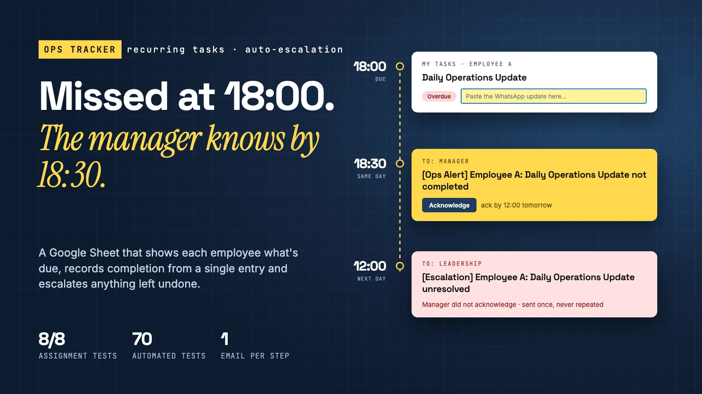
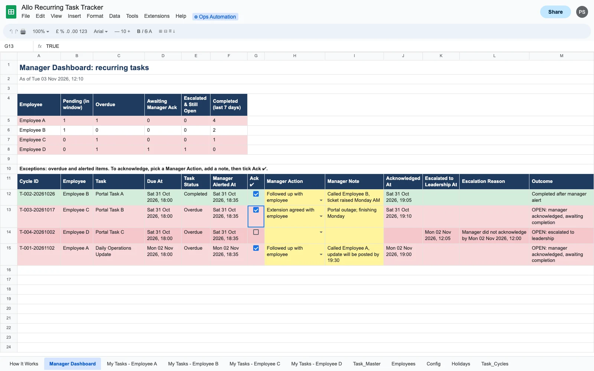
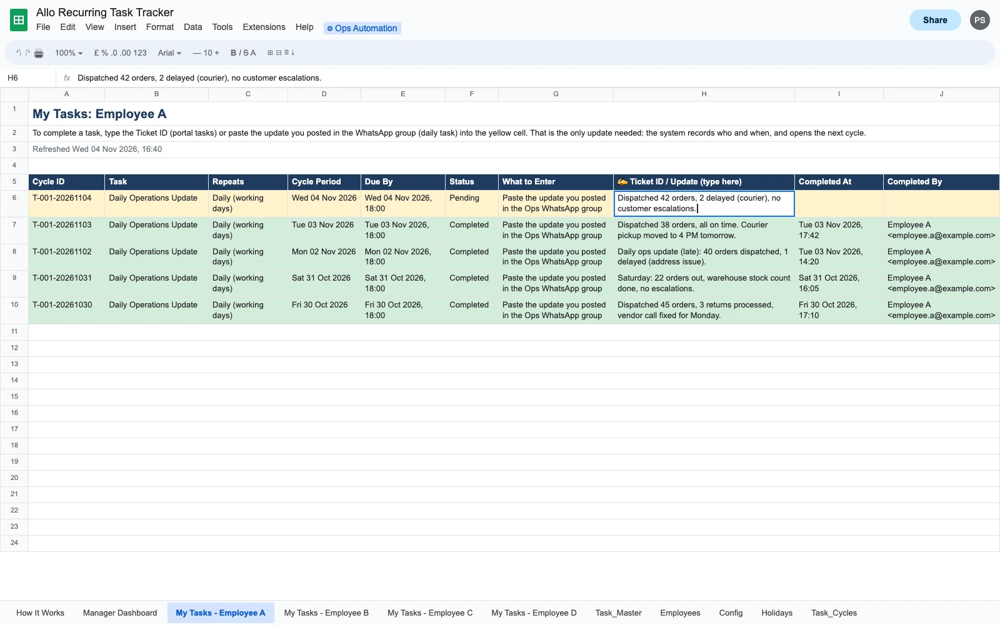
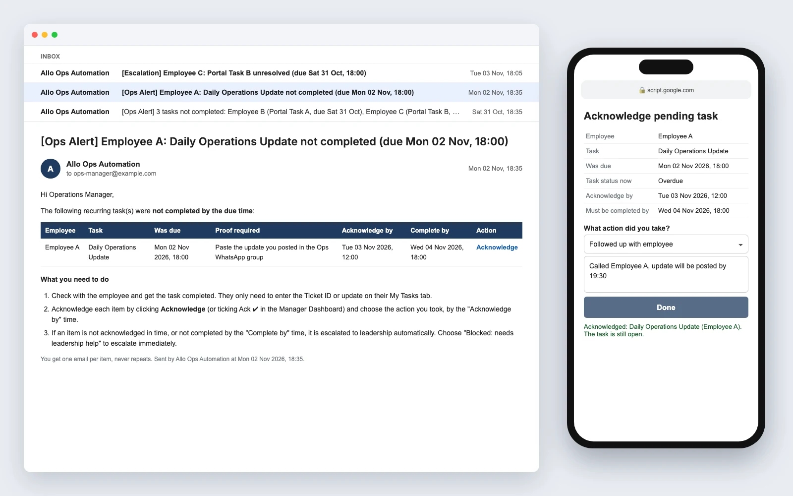
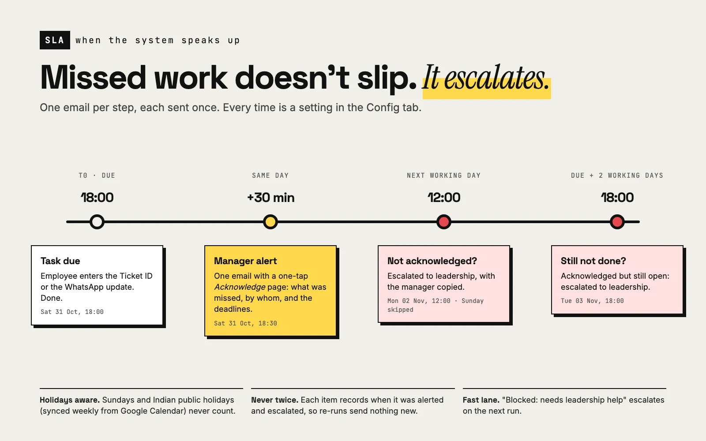
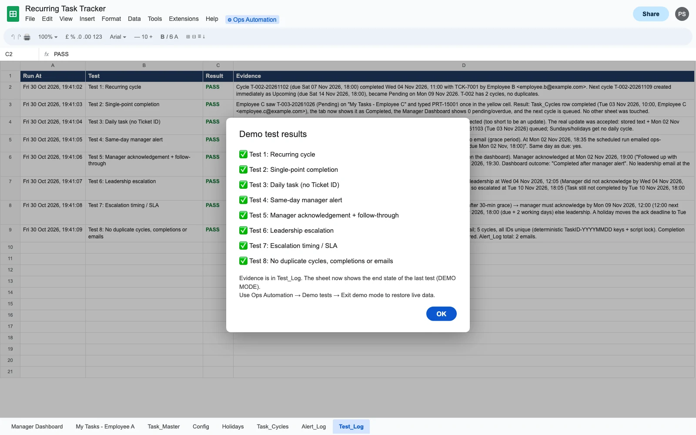

# Recurring Task Tracking & Escalation Automation

A Google Sheets + Apps Script system that tracks recurring operational tasks, tells each employee what is pending, records completion from a single entry, alerts the manager the same day when work is missed, and escalates to leadership when it stays unresolved.

Built for the **Allo Innoware AI Operations Manager assignment**. The full design, SLA reasoning and test cases are in [docs/DESIGN.md](docs/DESIGN.md).



## What it does

| | |
|---|---|
| **Recurring cycles** | Each task has a frequency (daily on working days, every 7, 15 or 30 days). New cycles open automatically. The schedule is anchored on the start date, so a late completion never shifts later due dates. |
| **One place per employee** | Each employee has a "My Tasks" tab showing what is overdue, pending and coming up. They type a single value: the portal **Ticket ID**, or for the daily task, the **WhatsApp update** they posted. The system records who completed it and when, closes the cycle and opens the next one. |
| **Manager Dashboard** | A team summary of pending, overdue, awaiting-acknowledgement and escalated items, plus an exceptions list with Ack ✔, the action taken and a note. |
| **Same-day alert** | One email to the manager 30 minutes after the 18:00 deadline, with a one-click **Acknowledge** page. |
| **Escalation** | Leadership is emailed once when the manager hasn't acknowledged by 12:00 the next working day, when the task is still open 2 working days after it was due, or when the manager asks for help. |
| **Working-day calendar** | Sundays are skipped. Public holidays sync weekly from Google's India holiday calendar (public holidays only, not observances). Company-specific days off can be added by hand. |
| **No duplicates** | Cycle IDs are deterministic, every run holds a script lock, and each alert level is recorded so it sends at most once per cycle. |
| **Built-in demo** | A simulated clock replays all 8 assignment test scenarios in about a minute, with evidence written to a Test_Log tab. |

## Screenshots

*Sample data. Names and emails are placeholders.*

**Manager Dashboard:** team summary, plus every overdue or alerted item with its acknowledgement and outcome.


**An employee's My Tasks tab:** the daily update is completed by pasting the WhatsApp message into the yellow cell.


**Same-day manager alert and one-tap acknowledgement**


**Escalation timeline**


**Built-in demo of the 8 assignment tests**


## How it fits together

```
Task_Master ─► Task_Cycles (system of record) ─► My Tasks tabs / Manager Dashboard
                    ▲            │
   employee entry ──┘            ├─ 18:30 same day ─► manager email ─► Acknowledge page
   (on-edit trigger)             └─ SLA breached ───► leadership email (once)
   hourly / daily time triggers ─┘
```

## Code layout

```
src/            Apps Script project (deployed with clasp)
  Logic.js      pure scheduling, SLA, validation and holiday-feed logic, unit-tested
  Config.js     sheet names, column layouts, defaults
  Repo.js       sheets read as tables, script lock, admin/UI/trigger guards
  Engine.js     automation run, completion, acknowledgement, edit handlers
  Views.js      My Tasks tabs and Manager Dashboard
  Mail.js       email builders
  WebApp.js     acknowledgement page (email link)
  Holidays.js   weekly public-holiday sync
  Access.js     per-role protections on every tab
  Setup.js      menu, setup, triggers, guide tab
  DemoTests.js  in-sheet demo of assignment Tests 1–8
test/           Jest unit + integration tests against an in-memory fake of Sheets, Mail, Lock and UrlFetch
```

## Quality and security

- **97 automated tests:** unit tests for the scheduling, SLA, holiday and admin rules, and integration tests that drive the whole system (including all 8 assignment scenarios) against a simulated spreadsheet.
- **CI** (GitHub Actions) runs lint, typecheck, unit and integration tests and a dependency audit on every push.
- **Role-based access:** every tab has a real protection. Employees can edit only their own My Tasks tab, managers only the dashboard, and admins (owner + ADMIN_EMAILS) everything, including every menu item. The rules re-apply automatically when the Employees or Config tab changes.
- **Public acknowledgement page:** each item has a random token. Admin functions refuse to run without the spreadsheet UI, and trigger handlers refuse to run without a genuine trigger ID, so the public URL can do nothing except acknowledge.
- **Hardening:** user text is HTML-escaped. Formula-like input is stored as plain text. The spreadsheet time zone is kept in line with the script's, which fixed a real date-shift bug.

## Develop

```bash
npm install
npm run check        # lint + typecheck + all tests
```

## Deploy your own copy

1. `npx clasp login`, and turn on the Apps Script API at https://script.google.com/home/usersettings.
2. `npx clasp create --type sheets --title "Recurring Task Tracker" --rootDir src`. clasp overwrites `src/appsscript.json`, so restore it from git afterwards.
3. `npm run push`, then `npx clasp deploy -d "ack web app"`.
4. In the Sheet, run **⚙ Ops Automation → Setup / repair sheets**, then **Install triggers**.
5. In the Config tab, set `MANAGER_EMAIL`, `LEADERSHIP_EMAIL` and `WEBAPP_URL` (the deployment's `/exec` URL).

## Copyright

© 2026 Prateek Sahni. All rights reserved. The source is published so it can be read and reviewed. See [LICENSE](LICENSE).
